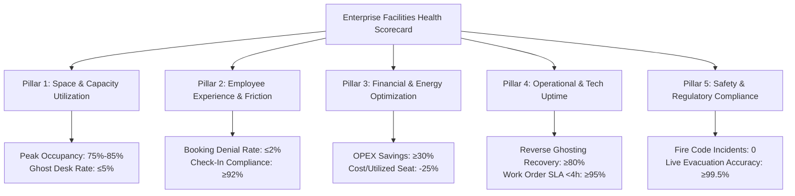

# 🏢 WorkInSync: Multi-Country Capacity Sizing & Facilities Governance Blueprint

<p align="center">
  
  
  
  
  
</p>

---

## 📑 Quick Navigation & Core Deliverables

- 📄 **[Full 12-Page Case Study Document (PDF)](docs/WorkInSync_TAM_Capacity_Planning_Case_Study.pdf)** — *Publication-grade executive report.*
- 📖 **[Case Study Markdown Document](docs/CASE_STUDY.md)** — *Interactive online reading experience with Mermaid architecture diagrams.*
- 🌐 **[Live Capacity Simulator & KPI Dashboard](dashboard/index.html)** — *Browser-based interactive slider model.*
- 📐 **[Capacity Simulation Engine](analytics_engine/capacity_simulation_engine.py)** — *Mathematical bounds, sharing ratios, and financial models.*
- 📊 **[Facilities KPI Evaluator](kpi_suite/facilities_kpi_evaluator.py)** — *Automated 5-pillar Facilities Management Health Scorecard.*
- ⚙️ **[Weekly Automated Facilities Audit](automation/weekly_facilities_audit.py)** — *Automated weekly executive reporting script.*

---

## 🎯 Executive Summary & Assessment Overview

### Assessment Scenario:
> **Company:** WorkInSync (by MoveInSync), Bangalore  
> **Role:** Technical Account Manager / Implementation Intern  
> **Prompt:** *"You are a facility manager running 3 offices across 3 countries. A total of 2000 people need to be seated. Employees come in only 3 days a week. How many min-max seats are required? Present with reasoning. Also, what KPIs will you use to assess whether the Facilities Team is doing a good job?"*

---

## 📐 Answer 1: Min-Max Seating Spectrum & Mathematical Reasoning

Total weekly workspace demand is governed by:
$$\text{Total Weekly Demand } (D) = N \times d = 2,000 \text{ employees} \times 3 \text{ days/week} = 6,000 \text{ Person-Days / Week}$$

Assuming a standard corporate 5-day operating week ($W = 5$ days, Monday–Friday):

```mermaid
graph LR
    subgraph Capacity Bounds [2,000 Headcount @ 3 Days/Week]
        Min[1,200 Seats<br>Theoretical Floor<br>Uniform 5-Day (1.67:1)] --> Opt[1,380 Seats<br>Recommended Optimal<br>WorkInSync + 15% Buffer]
        Opt --> Peak[1,700 Seats<br>Unmanaged Peak<br>TWaT Clustering 85%]
        Peak --> Max[2,000 Seats<br>Theoretical Ceiling<br>1:1 Dedicated Desks]
    end
    style Min fill:#e0f2fe,stroke:#0284c7,stroke-width:2px
    style Opt fill:#dcfce7,stroke:#16a34a,stroke-width:3px
    style Peak fill:#fef3c7,stroke:#f59e0b,stroke-width:2px
    style Max fill:#fee2e2,stroke:#ef4444,stroke-width:2px
```

### Seating Architecture Comparison Matrix

| Model Architecture | Total Seats | Sharing Ratio | Desk Allocation % | Annual OPEX Savings | Operational Trade-Off & Feasibility |
| :--- | :---: | :---: | :---: | :---: | :--- |
| **1. Theoretical Minimum** | **1,200** | 1.67 : 1 | 60.0% | $4,192,000 | **Floor:** Requires rigid uniform 5-day cohorting. Zero buffer for churn, team overlap, or visitors. |
| **2. WorkInSync Optimal** | **1,380** | **1.45 : 1** | **69.0%** | **$3,248,800** | **RECOMMENDED:** Balanced cohorting + 15% dynamic buffer (180 desks). Zero bump friction. |
| **3. Unmanaged Organic Peak** | **1,700** | 1.18 : 1 | 85.0% | $1,572,000 | **Real-World Peak:** Tuesday-Thursday clustering ("TWaT" effect) leaves Mon/Fri empty. |
| **4. Theoretical Maximum** | **2,000** | 1.00 : 1 | 100.0% | $0 (Baseline) | **Ceiling:** 1:1 dedicated seating. Wastes 40% of real estate capital every single day. |

---

## 🌍 Multi-Country Allocation Model (3 Offices across 3 Countries)

Commercial real estate costs vary widely across international markets. Below is the multi-country allocation modeled across Bangalore, New York, and London:

| Office Location | Role / Hub | Headcount | Min Seats (60%) | Optimal (69%) | Peak (85%) | Dedicated Max | Annual Cost / Desk | Annual Savings vs 1:1 |
| :--- | :--- | :---: | :---: | :---: | :---: | :---: | :---: | :---: |
| **Bangalore, India** | Tech & Core Operations | 1,000 (50%) | 600 | **690** | 850 | 1,000 | $2,500 | **$775,000 / yr** |
| **New York, USA** | Commercial HQ & Sales | 600 (30%) | 360 | **414** | 510 | 600 | $8,500 | **$1,581,000 / yr** |
| **London, UK** | EMEA Regional Hub | 400 (20%) | 240 | **276** | 340 | 400 | $7,200 | **$892,800 / yr** |
| **Global Total** | **3 Enterprise Hubs** | **2,000** | **1,200** | **1,380** | **1,700** | **2,000** | **$5,240 (Avg)** | **$3,248,800 / yr (31.0%)** |

> **Financial Bottom Line:**  
> Moving from 1:1 dedicated seating to WorkInSync's 1,380-seat model eliminates **620 redundant desks globally**, delivering **$3,248,800 in annual recurring OPEX savings** ($9.74M across a 3-year lease).

---

## 📊 Answer 2: Strategic Facilities Management KPI Framework



### 1. Space & Capacity Utilization
- **Peak Seat Utilization Rate (Target: 75% – 85%):** The Goldilocks zone. Above 90% creates crowding friction; below 65% signals capital waste.
- **Ghost Desk Rate (Target: $\le 5.0\%$):** Desks booked but never claimed via physical badge/QR check-in.
- **Desk-to-Employee Sharing Ratio (Target: 1.45:1):** Tracks consolidation efficiency.

### 2. Employee Experience (EX) & Friction
- **Booking Denial (Bump) Rate (Target: $\le 2.0\%$):** Percentage of failed reservation attempts. Primary policy failure indicator.
- **Check-In Compliance Rate (Target: $\ge 92.0\%$):** Verified check-ins across mobile app, turnstiles, and kiosks.
- **Team Neighborhood Co-Location Score (Target: $\ge 85.0\%$):** % of employees seated within 20m of immediate team members.
- **Workplace CSAT (Target: $\ge 4.4 / 5.0$):** Employee sentiment score on desk comfort and workplace support.

### 3. Financial & Real Estate Efficiency
- **Real Estate OPEX Savings vs 1:1 (Target: $\ge 30.0\%$):** Demonstrates **$3.25M net savings/yr**.
- **Cost per Utilized Desk (Target: -25% reduction):** Real estate cost divided by daily average occupants.
- **HVAC & Lighting Energy Consumption (Target: -20% YoY):** Energy savings via targeted Friday floor shutdowns.

### 4. Operational & Technology Uptime
- **Reverse Ghosting Desk Recovery Rate (Target: $\ge 80.0\%$):** Desks auto-released after 30-min no-shows that are rebooked by others.
- **Kiosk & QR Scanner Uptime (Target: $\ge 99.8\%$):** Hardware reliability at turnstiles and lobby reception.
- **Facilities Work Order SLA (Target: $\ge 95.0\%$ resolved in $<4\text{h}$):** Rapid repair turnaround for docks, monitors, and chairs.

### 5. Safety, Floor Density & Compliance
- **Max Floor Density Adherence (Target: 100% / 0 Incidents):** Zero fire code violations across India, US, and UK safety mandates.
- **Evacuation Roster Accuracy (Target: $\ge 99.5\%$):** Live sync between WorkInSync check-ins and emergency roll-calls.

---

## 🛠️ WorkInSync Technical Account Manager Playbook

1. **Department Neighborhoods:** Engineering assigned Tue/Wed/Thu; Sales & Product assigned Mon/Wed/Fri to level demand across the week.
2. **Automated Reverse Ghosting:** If an employee has not checked in via mobile QR or RFID turnstile by 10:00 AM, the desk is auto-released to the waitlist pool.
3. **Multi-Modal Check-In:** Supporting mobile app camera scan, entry kiosk RFID tap, and passive Wi-Fi association.
4. **Executive Agile Pods:** Flexible team spaces that balance executive privacy with hybrid space efficiency.

---

## 🚀 Quick Start & Local Execution

### 1. Run the Multi-Country Capacity Simulation:
```bash
python3 analytics_engine/capacity_simulation_engine.py
```

### 2. Run the Facilities KPI Evaluation Suite:
```bash
python3 kpi_suite/facilities_kpi_evaluator.py
```

### 3. Run the Automated Weekly Audit Script:
```bash
python3 automation/weekly_facilities_audit.py
```

### 4. Open the Interactive Web Simulator:
Open `dashboard/index.html` in any browser to adjust headcount, days/week, and buffer sliders dynamically.

---

## 👨‍💻 Technical Account Manager 30-60-90 Day Commitment

- **Days 1–30 (Discovery & Baseline):** Audit badge turnstile records, Active Directory org charts, and floorplans across Bangalore, New York, and London. Establish baseline peak utilization and ghost desk rates.
- **Days 31–60 (WorkInSync Deployment & Pilot):** Deploy WorkInSync with team neighborhoods, multi-modal check-in kiosks, and reverse-ghosting rules. Pilot in London (400 HC) before global rollout.
- **Days 61–90 (Global Scaling & QBR Governance):** Expand to Bangalore (1,000 HC) and New York (600 HC). Publish the first automated Executive Facilities Health Scorecard and lock in **$3.25M in annual lease consolidation savings**.

---

<p align="center">
  <b>Built for WorkInSync (MoveInSync) by Ankur Choudhary</b> &bull; Technical Account Manager Candidate<br>
  <a href="docs/WorkInSync_TAM_Capacity_Planning_Case_Study.pdf">Download Executive PDF</a> &bull; <a href="docs/CASE_STUDY.md">Read Case Study Online</a>
</p>
