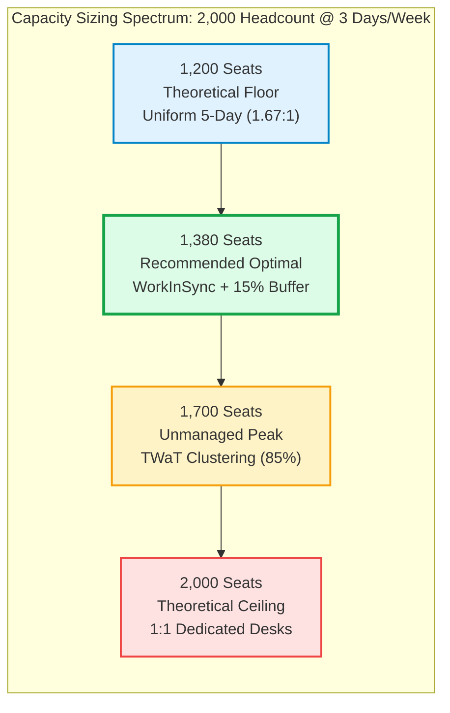
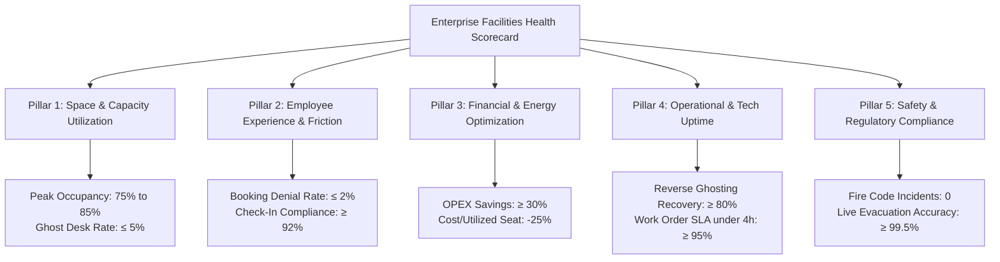

# WorkInSync (by MoveInSync): Multi-Country Workplace Capacity Sizing & Facilities KPI Framework
## Technical Account Manager / Implementation Specialist Assessment
**Author:** Ankur Choudhary ([@Ankurchoudhary75](https://github.com/Ankurchoudhary75))  
**Role:** Technical Account Manager / Implementation Intern  
**Company:** WorkInSync (by MoveInSync), Bangalore  
**Scenario:** 3 offices across 3 countries, 2,000 total headcount, 3 days/week in-office hybrid policy.  
**Official Executive Deliverable:** [Download Complete 12-Page PDF](WorkInSync_TAM_Capacity_Planning_Case_Study.pdf)

---

## 1. Executive Summary & Assessment Questions Answered

### Assessment Questions:
1. *You are a facility manager running 3 offices across 3 countries. A total of 2000 people need to be seated. Employees come in only 3 days a week. How many min-max seats are required? Present with reasoning.*
2. *Also, what KPIs will you use to assess whether the Facilities Team is doing a good job?*

---

### Direct Answer 1: Min-Max Sizing Spectrum & Reasoning

| Model Architecture | Total Seats | Sharing Ratio | Desk Allocation % | Annual OPEX Savings | Operational Trade-Off & Feasibility |
| :--- | :---: | :---: | :---: | :---: | :--- |
| **1. Theoretical Minimum** | **1,200** | 1.67 : 1 | 60.0% | $4,192,000 | **Floor:** Requires rigid uniform 5-day cohorting. Zero buffer for churn, team overlap, or visitors. |
| **2. WorkInSync Optimal** | **1,380** | **1.45 : 1** | **69.0%** | **$3,248,800** | **RECOMMENDED:** Balanced cohorting + 15% dynamic buffer (180 desks). Zero bump friction. |
| **3. Unmanaged Organic Peak** | **1,700** | 1.18 : 1 | 85.0% | $1,572,000 | **Real-World Peak:** Tuesday-Thursday clustering ("TWaT" effect) leaves Mon/Fri empty. |
| **4. Theoretical Maximum** | **2,000** | 1.00 : 1 | 100.0% | $0 (Baseline) | **Ceiling:** 1:1 dedicated seating. Wastes 40% of real estate capital every single day. |

---

## 2. Mathematical Reasoning & Sensitivity Analysis

### Foundational Sizing Equation
$$\text{Total Weekly Demand } (D) = N \times d = 2,000 \times 3 = 6,000 \text{ Person-Days / Week}$$

Assuming a standard corporate 5-day operating week ($W = 5$ days, Monday–Friday):

1. **Theoretical Floor ($S_{\text{min}}$):**
   $$S_{\text{min}} = \frac{D}{W} = \frac{6,000}{5} = \mathbf{1,200 \text{ seats}} \quad (\text{Sharing Ratio } 1.67:1)$$
2. **WorkInSync Managed Optimal ($S_{\text{opt}}$):**
   $$S_{\text{opt}} = S_{\text{min}} \times (1 + \beta) = 1,200 \times (1 + 0.15) = \mathbf{1,380 \text{ seats}} \quad (\text{Sharing Ratio } 1.45:1)$$
   *Where $\beta = 0.15$ (15% dynamic buffer = 180 seats to prevent booking bumps).*
3. **Unmanaged Mid-Week Peak ($S_{\text{peak}}$):**
   $$S_{\text{peak}} = N \times 0.85 = \mathbf{1,700 \text{ seats}} \quad (\text{Sharing Ratio } 1.18:1)$$
4. **Theoretical Maximum ($S_{\text{max}}$):**
   $$S_{\text{max}} = N = \mathbf{2,000 \text{ seats}} \quad (\text{Sharing Ratio } 1.00:1)$$

---

## 3. Multi-Country Office Allocation (3 Countries)

| Office / Country | Function / Hub | Headcount | Min (60%) | Optimal (69%) | Peak (85%) | Max (100%) | Annual Cost/Desk | Net Annual Savings |
| :--- | :--- | :---: | :---: | :---: | :---: | :---: | :---: | :---: |
| **Bangalore, India** | Tech & Ops HQ | 1,000 (50%) | 600 | **690** | 850 | 1,000 | $2,500 | **$775,000 / yr** |
| **New York, USA** | Commercial HQ | 600 (30%) | 360 | **414** | 510 | 600 | $8,500 | **$1,581,000 / yr** |
| **London, UK** | EMEA Regional | 400 (20%) | 240 | **276** | 340 | 400 | $7,200 | **$892,800 / yr** |
| **Total Global** | **3 Hubs** | **2,000** | **1,200** | **1,380** | **1,700** | **2,000** | **$5,240 (Avg)** | **$3,248,800 / yr** |

---

## 4. Direct Answer 2: Strategic Facilities Management KPIs

To assess whether the Facilities Team is doing a world-class job, we establish **5 Core Governance Pillars**:

### 1. Space & Capacity Utilization KPIs
- **Peak Seat Utilization Rate (Target: 75.0% – 85.0%):** Measures peak hour occupancy. $>90\%$ signals overcrowding risk; $<65\%$ signals capital underutilization.
- **Ghost Desk Rate (Target: $\le 5.0\%$):** Percentage of booked desks where no physical check-in occurred. Measures desk hoarding.
- **Desk-to-Employee Sharing Ratio (Target: 1.45:1):** Tracks efficiency of flexible seating consolidation.

### 2. Employee Experience (EX) & Friction KPIs
- **Booking Denial (Bump) Rate (Target: $\le 2.0\%$):** Failed booking attempts due to full floor capacity. Primary friction indicator.
- **Check-In Compliance Rate (Target: $\ge 92.0\%$):** Verified check-ins via QR code, RFID badge, or Wi-Fi association.
- **Team Neighborhood Co-Location Score (Target: $\ge 85.0\%$):** % of employees seated within 20m of their immediate functional team.
- **Workplace Experience CSAT (Target: $\ge 4.4 / 5.0$):** Quarterly pulse survey measuring desk comfort and cleanliness.

### 3. Financial & Real Estate Efficiency KPIs
- **Real Estate OPEX Savings vs 1:1 (Target: $\ge 30.0\%$):** Realizes **$3.25M/year** in commercial rent, HVAC, and cleaning savings.
- **Cost per Utilized Desk (Target: -25% reduction):** Total annual real estate expenditure divided by daily average occupants.
- **HVAC & Lighting Energy Consumption per Headcount (Target: -20% YoY):** Savings achieved by targeted zone shutdowns on low-occupancy days (Fridays).

### 4. Operational & Technology Performance KPIs
- **Reverse Ghosting Desk Recovery Rate (Target: $\ge 80.0\%$):** Desks automatically released after 30-minute no-show that are rebooked by walk-ins.
- **Workplace Kiosk & Display Uptime (Target: $\ge 99.8\%$):** Continuous operational reliability of lobby kiosks and digital floor maps.
- **Facilities Work Order SLA (Target: $\ge 95.0\%$ resolved in $<4\text{ hours}$):** Rapid turnaround for monitor, docking station, and chair repairs.

### 5. Safety, Floor Density & Statutory Compliance KPIs
- **Max Floor Density Adherence (Target: 100% / 0 Incidents):** Ensures floor headcount never breaches statutory fire codes in Bangalore, New York, or London.
- **Real-Time Evacuation Roster Accuracy (Target: $\ge 99.5\%$):** Correlation between live WorkInSync logs and physical turnstile badges for emergency roll calls.

---

## 5. Technical Account Manager Implementation Playbook

As WorkInSync's Technical Account Manager, achieving the 1,380 optimal capacity requires 4 operational levers:
1. **Department Neighborhoods:** Engineering assigned Tue/Wed/Thu; Sales/Product assigned Mon/Wed/Fri to level demand across the week.
2. **Reverse Ghosting Automation:** If an employee has not checked in via mobile QR or RFID turnstile by 10:00 AM, the desk is auto-released to the waitlist pool.
3. **Multi-Modal Check-In:** Supporting mobile app camera scan, entry kiosk RFID tap, and passive Wi-Fi association.
4. **Executive Agile Pods:** Flexible team spaces that balance executive privacy with hybrid space efficiency.

---

## 6. Production Codebase Overview

- 🐍 **[`analytics-engine/capacity_simulation_engine.py`](../analytics-engine/capacity_simulation_engine.py):** Simulation engine calculating bounds, sharing ratios, and financial models.
- 🐍 **[`kpi-suite/facilities_kpi_evaluator.py`](../kpi-suite/facilities_kpi_evaluator.py):** Automated Facilities Health Scorecard engine.
- 🌐 **[`dashboard/index.html`](../dashboard/index.html):** Interactive slider simulator for real-time executive presentations.
